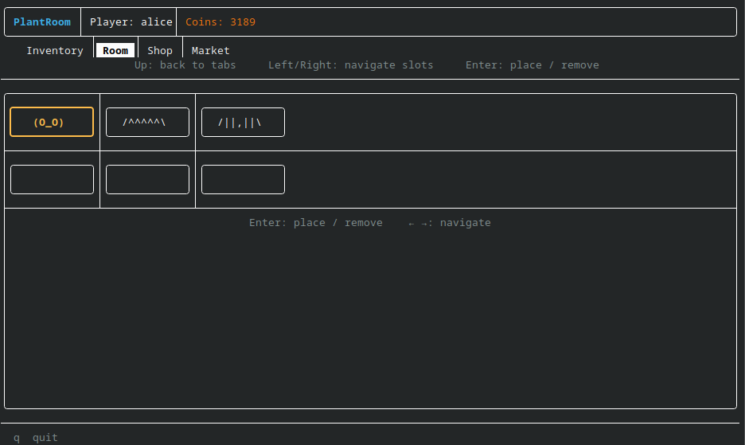
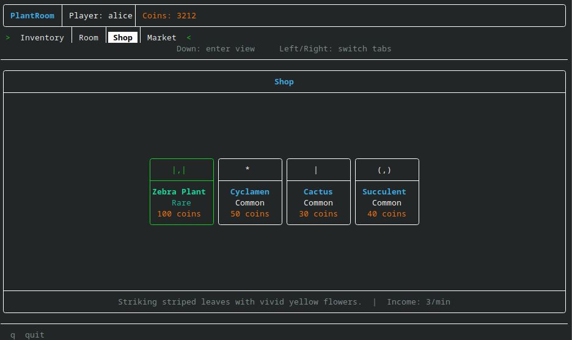
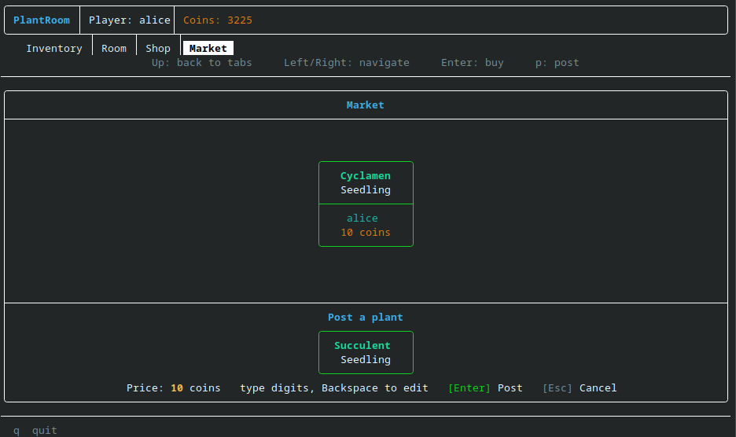
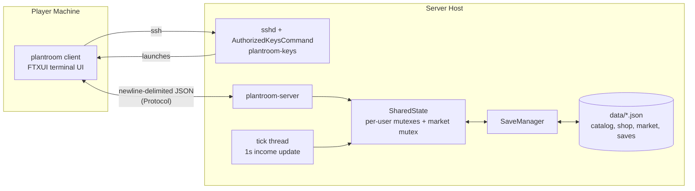

# PlantRoom

A multiplayer idle plant-growing game played over `ssh`: no client to install, no browser tab, just a terminal.

Log in, buy plants, grow them in real time, and trade them with other players on a shared marketplace, all in a
terminal UI that redraws itself once a second while you watch.

> **Status:** this isn't currently deployed anywhere, so `ssh plantroom@<server-ip>` below is just an example, not
> a live address: there's no server running for it right now. The SSH login flow is real and works (tested by
> SSHing into localhost), and would work the same way against a real host. It just needs someone to deploy it.
> Everything else runs locally out of the box - see [Running locally](#running-locally).

<p align="center">
  
  
</p>
<p align="center">
  
</p>

## What it is

Each player gets a room with six slots. Plants placed in a slot grow through three stages — Seedling, Growing,
Mature — on a real-world timer, and generate coins passively the whole time, online or off. Coins buy more plants
from the shop. Grown plants can be moved to the **Market** and sold directly to other connected players, or bought
off it in turn.

Authentication is by SSH key. The first time you connect you register. Every time after that, `sshd` looks up your
key and drops you straight into your saved room with no login screen.

## How it's built

- **Client/server split.** `plantroom-server` is a standalone daemon that holds all shared state in memory,
  listens on a Unix domain socket, and handles each connected client on its own thread, saving to per-user JSON
  on disconnect. `plantroom` is a thin FTXUI client with no state of its own: it renders whatever the server last
  sent.
- **Locking.** Each user's data is guarded by its own `std::shared_mutex` rather than one global lock, so unrelated
  players don't block each other. The marketplace has a separate mutex. A dedicated tick thread goes through
  online users once a second to update their income, independent of the connection-handling threads.
- **Protocol.** Client and server speak newline-delimited JSON over the socket: a small hand-rolled `Protocol`
  module and a request/response loop per session, no HTTP framework involved.
- **SSH login.** Uses OpenSSH's `AuthorizedKeysCommand` hook: on every connection attempt, `sshd` calls a lookup
  script that checks the presented key against `auth.json` and returns a `command=` directive that either launches
  the game already logged in as that user or falls through to the in-app login/registration screen. New users log
  in with a password (SHA-256 + per-user salt via OpenSSL) and their key is registered automatically for next time.
- **Offline progress.** When you log back in, the server replays however much real time passed through the same
  income engine used while you're online, so idle players catch up correctly instead of the timer resetting.



## Tech stack

C++20 · CMake (FetchContent) · [FTXUI](https://github.com/ArthurSonzogni/FTXUI) for the terminal UI ·
[nlohmann/json](https://github.com/nlohmann/json) for the wire protocol and persistence · OpenSSL (libcrypto) for
password hashing · POSIX Unix domain sockets · OpenSSH `AuthorizedKeysCommand` for keyless login.

## Project layout

```
src/
├── server/        PlantRoomServer, Session, SharedState, AuthStore, Protocol
├── client/         ServerConnection (thin socket + protocol client)
├── ui/              App, LoginView, RoomView, ShopView, InventoryView, MarketView, StatusBar
├── core/           User, Plant, PlantSpecies, Shop, MarketListing, IncomeEngine
├── persistence/    SaveManager (per-user JSON saves), CatalogLoader (plants.json)
├── scripts/        plantroom-keys, sshd_plantroom.conf: the SSH keyless-login integration
└── data/           plants.json, shop.json, auth.json, market.json, saves/
```

## Building on Linux

### Prerequisites

CMake 3.20+, a C++20-capable compiler (GCC 11+), git, and OpenSSL development headers.

On Fedora:
```
sudo dnf install cmake gcc-c++ git openssl-devel
```

On Ubuntu/Debian:
```
sudo apt install cmake g++ git libssl-dev
```

### Build

```
cd src
cmake -B build -S .
cmake --build build
```

CMake fetches FTXUI and nlohmann/json automatically on the first build: this takes a few minutes the first time.

This produces two executables in `build/`:
- `plantroom-server`: the server daemon
- `plantroom`: the client

It also copies `data/` into `build/data/`, which is where the server reads and writes everything at runtime.

### Building on Windows

The server uses POSIX sockets and is meant to run on a Linux host, so it doesn't build natively on Windows. The
intended way to play is `ssh plantroom@<server-ip>` into a Linux machine running the server - there's no supported
Windows build.

## Running locally

Open two terminals. In the first, start the server:

```
./build/plantroom-server
```

In the second, start the client:

```
./build/plantroom
```

The server must be running before the client connects, and keeps running until you kill it (Ctrl+C). A client's
data is saved automatically on disconnect.

## SSH setup

Only needed for the full SSH-based login flow, where users connect with `ssh` and the game launches automatically.
For local testing, [Running locally](#running-locally) above is enough on its own. This also isn't wired up to any
public server right now (see the status note at the top): these are the steps to set it up yourself.

`src/scripts/` contains two files:

`sshd_plantroom.conf` configures sshd to use the key lookup script. Copy it to `/etc/ssh/sshd_config.d/` and
restart sshd:

```
sudo cp src/scripts/sshd_plantroom.conf /etc/ssh/sshd_config.d/
sudo systemctl restart sshd
```

`plantroom-keys` is the script sshd calls for each incoming connection. It reads `auth.json` and decides whether to
launch the client directly or show the login screen. Edit the two path variables at the top of the script to point
to your `auth.json` and the built `plantroom` binary:

```bash
AUTH_JSON="/path/to/build/data/auth.json"
BINARY="/path/to/build/plantroom"
```

Then install it where sshd expects it:

```
sudo cp src/scripts/plantroom-keys /usr/local/bin/plantroom-keys
sudo chmod 755 /usr/local/bin/plantroom-keys
```

After this, users connect with:

```
ssh plantroom@<server-ip>
```

On first connection they see the register/login screen. On subsequent connections with the same key, the game
launches directly.

### Testing SSH locally

If you don't have a remote server, you can test the full SSH flow on your own machine by SSHing to localhost.

Create the `plantroom` Linux user:

```
sudo useradd plantroom
sudo mkdir -p /home/plantroom
sudo chown plantroom:plantroom /home/plantroom
```

Make sure you have an SSH key pair. If not, generate one:

```
ssh-keygen -t ed25519
```

Install the script and config as described above, then start the server and SSH to yourself:

```
./build/plantroom-server &
ssh plantroom@localhost
```

## Playing

**Coins** build up passively at a rate set by the plants currently in your room slots, whether the app is open or
not: offline progress is applied the moment you log back in.

**Buying plants**: go to the Shop tab and press Enter on a plant to add it to your inventory.

**Placing plants**: go to the Room tab, select an empty slot, then pick a plant from the inventory list. Plants
grow through three stages, Seedling → Growing → Mature, over real time.

**Removing plants**: select an occupied slot and press Enter to move it back to inventory. Accumulated growth
time is preserved.

**Marketplace**: in the Market tab, post a plant from your inventory at a price of your choosing, or buy a plant
another player has listed.

**Quitting**: press `q` to save and exit cleanly. Saving also happens automatically when the connection closes.

## Data files

The server reads everything from `data/` in its working directory (`build/data` when running locally):

| File | Purpose |
|---|---|
| `plants.json` | Full species catalog: growth durations, income rates, ASCII art per stage |
| `shop.json` | Species IDs currently available in the shop |
| `auth.json` | Usernames, hashed passwords, salts, registered public keys: created on first registration |
| `market.json` | Marketplace listings, persisted across server restarts |
| `saves/<username>.json` | One file per user: coins, inventory, room slots |
